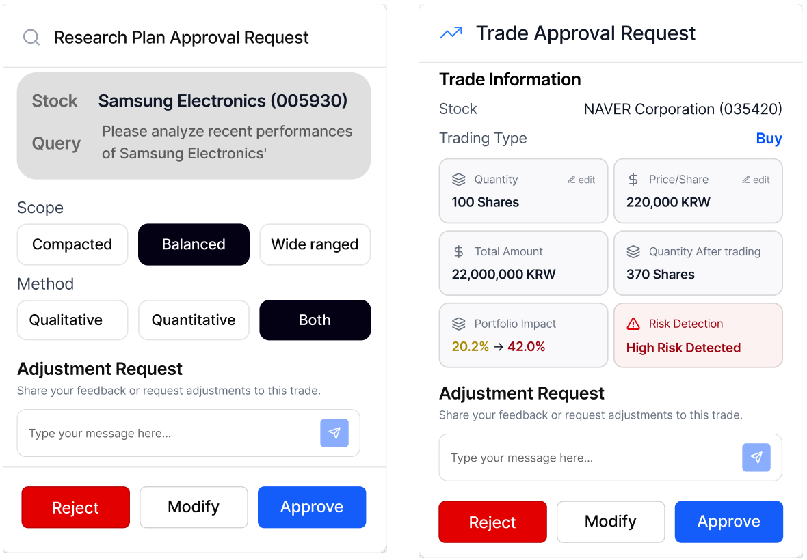
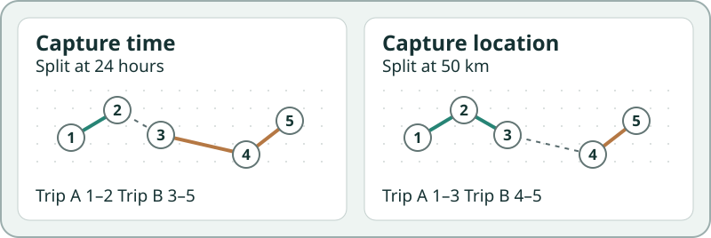

# Seongmin Hwang

[한국어](./README.md) · **English**

<picture>
  <source media="(prefers-reduced-motion: reduce)" srcset="assets/project-still.png">
  
</picture>

## Projects

### HAMA · What can you change before placing an order?

For a two-person capstone, I built the frontend that lets users **follow the AI's analysis and approve, revise, or reject its proposals**. In the final demo, users could review the research plan before analysis began and review a simulated order before it was placed. In Next.js, I used server-sent events to show progress and passed the user's revised order parameters to the backend.

[Presentation video](https://www.youtube.com/watch?v=WFqmJOUc1qU&t=95s) · [Frontend code](https://github.com/HAMA-team/HAMA-frontend-v2) · Silver Award, 2025 Capstone Design Showcase

<b>See the research plan and order review screens</b>

Users can choose the scope and method of the research, then change the quantity and price when they review a proposed order.

### TripTrace · The same photos tell different stories by time and distance

TripTrace groups photos into trips using their timestamps and GPS coordinates, then displays them on a map. I implemented the trip segmentation by **treating each photo as a vertex and weighting the edges by elapsed time or distance**. The app builds a minimum spanning tree with Prim's algorithm and cuts edges that exceed the selected threshold.

[Screenshots and design](https://github.com/seongmini/triptrace#readme) · [Trip segmentation code](https://github.com/seongmini/triptrace/blob/master/test/trips.mjs)

<b>Compare the time and distance rules</b>

Say photo 3 was taken in the same neighborhood as photo 2, but two days later. The **24-hour** rule can split them into separate trips, while the **50 km** rule can group them together.

[Time-based view](https://github.com/seongmini/triptrace/blob/master/photosforreadme/triptrace-time-based-trips.png) · [Distance-based view](https://github.com/seongmini/triptrace/blob/master/photosforreadme/triptrace-distance-based-trips.png)

### Sticky Markdown Note · Pick up where you left off

I built this Electron app because I wanted to keep several notes open beside my work. It **saves notes as `.md` files and restores each open window's position and size** when you reopen the app. I also published a Windows installer.

[Source code](https://github.com/seongmini/sticky-markdown-note) · [Installer](https://github.com/seongmini/sticky-markdown-note/releases/latest)

## IXLAB · Getting a baseball highlight tool ready for a user study

**PromptBall** is a research prototype that turns written requests for baseball plays into highlight videos. I improved the React interface from game selection through playback. While a video was being generated, the interface showed how many clips were ready using updates over WebSockets. After generation, users could click the timeline to jump to a clip. I also helped run the user study, improved logging to connect requests with generated results, and compiled viewing times for each participant.

<b>Game data preparation, feedback on failed requests, and video processing</b>

- I automated splitting new game footage by inning, transcribing the audio, and generating summaries in one run. I also handled inning order in extra-inning games.
- I added separate messages for requests involving a player outside the lineup and plays that did not happen in the selected game, so users knew how to revise their requests.
- I identified video re-encoding as a bottleneck and switched to FFmpeg stream copying. In internal lab tests, generation time per video went **from 3–10 minutes to 10–30 seconds**.

