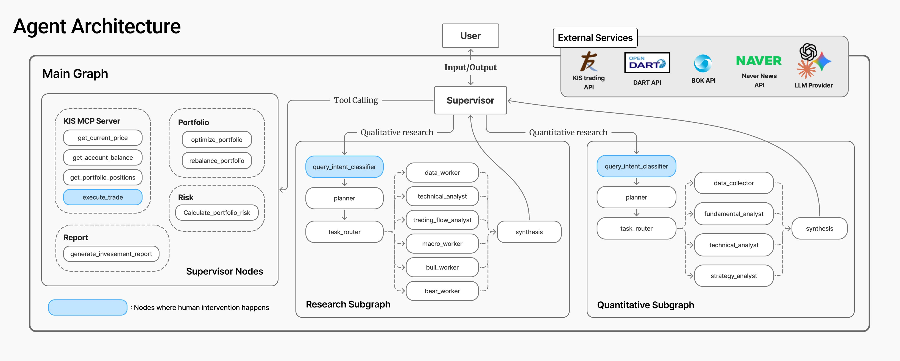
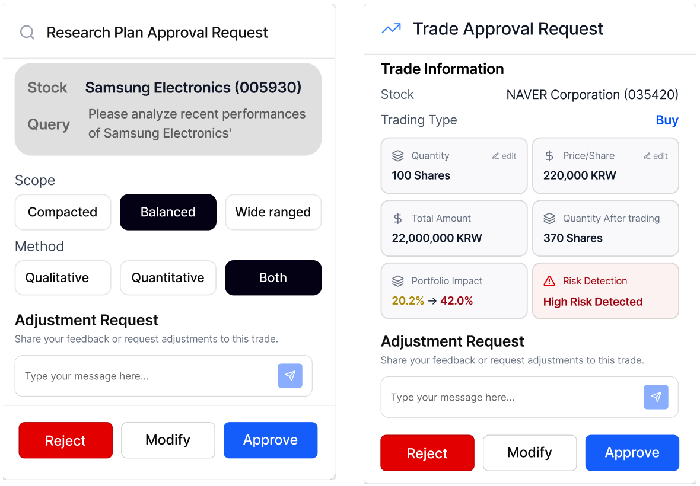
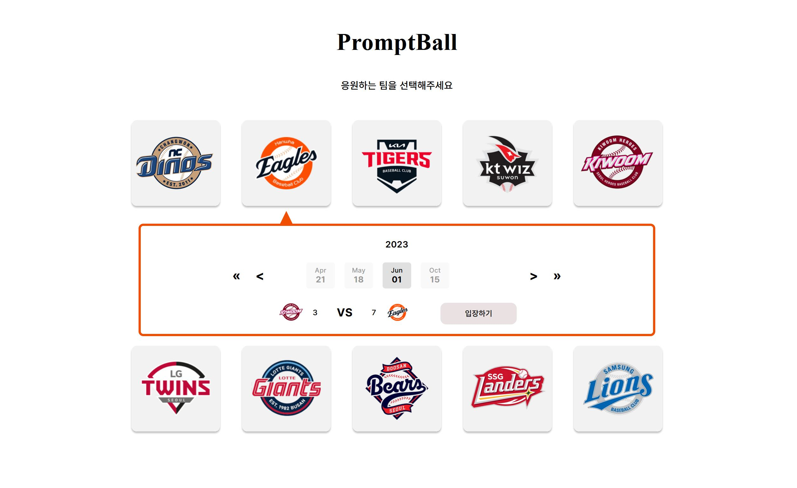
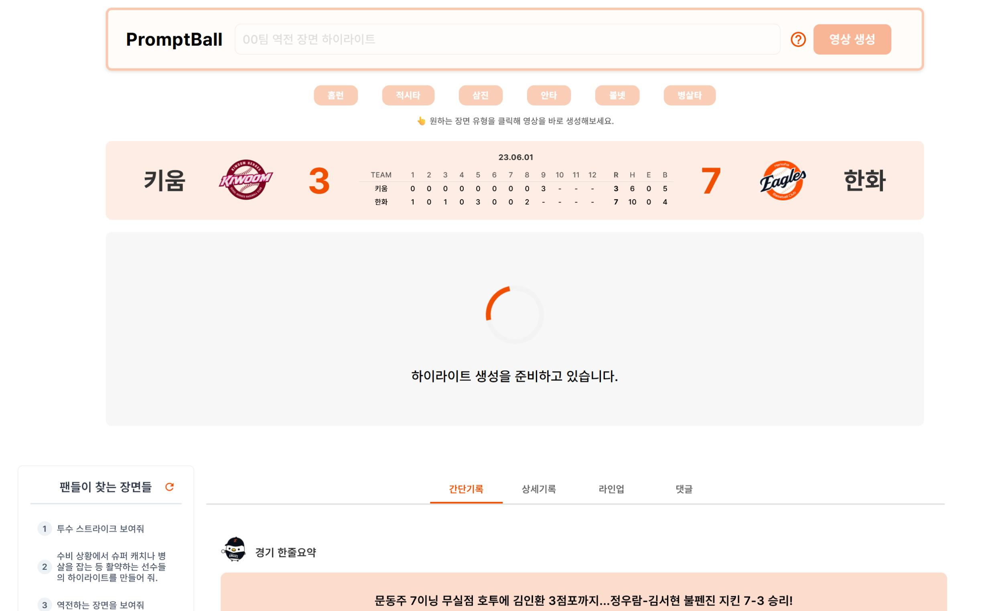
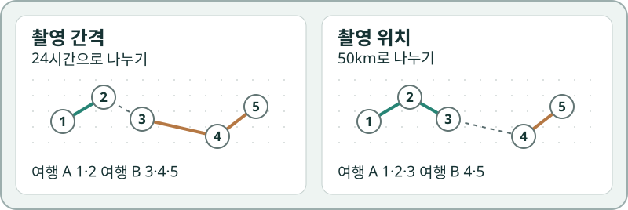

# 황성민 (Seongmin Hwang)

[English](https://github.com/seongmini) | **한국어**

코딩을 가르치고 소프트웨어를 만듭니다. 학생이 막혔던 문제를 자기 힘으로 풀어낼 때처럼, 누군가 하고 싶던 일에 첫발을 내딛도록 돕는 도구에 관심이 있습니다.

## 기술 스택

**프로그래밍 언어**  

**서버와 데이터**  

**AI와 미디어 처리**  

**앱 개발과 실시간 연동**  

## 프로젝트

### HAMA

HAMA는 AI 에이전트가 종목을 조사하고 모의 주문을 준비하는 서비스입니다. 2인 캡스톤에서 **사용자가 분석 계획을 검토하고 주문 여부를 결정하는 절차**를 설계하고 구현했습니다. 처음에는 다섯 종류의 검토 화면을 설계했고, 최종 시연은 분석 전과 주문 전 두 지점에 집중했습니다. 백엔드 담당 팀원과 진행 상태와 사용자 결정을 주고받는 API 형식을 정했고, 실제 서버 응답을 대조하며 요청부터 결과 확인까지 점검했습니다. 2025 캡스톤디자인 발표회에서 은상을 받았습니다.

[발표 영상](https://www.youtube.com/watch?v=WFqmJOUc1qU&t=95s) | [프론트엔드 코드](https://github.com/HAMA-team/HAMA-frontend-v2)

<b>팀의 에이전트 아키텍처 보기</b>

캡스톤 최종 포스터에 실린 팀 도식입니다. LangGraph의 Supervisor는 요청을 정성 분석이나 정량 분석으로 보내거나 포트폴리오, 위험 분석, 거래 도구를 호출합니다. 파란색은 사용자가 개입하는 지점입니다. 저는 서버의 진행 상태 이벤트와 승인 API를 사용자 화면에 연결했습니다.

[에이전트 구성 설명](https://github.com/HAMA-team/HAMA-frontend-v2/blob/main/docs/how_it_works_agent_architecture.md)

<b>분석 계획과 주문 검토 화면 열기</b>

분석 계획에서는 조사 범위와 방법을 고르고, 주문 화면에서는 수량과 가격을 수정할 수 있습니다.

### PromptBall

**IXLAB 학부 연구원 인턴**

PromptBall은 원하는 야구 장면을 글로 요청하면 하이라이트를 만들어 주는 연구용 서비스입니다. **새 경기의 데이터 준비를 자동화**하고, 경기 선택부터 결과 영상에서 원하는 장면을 다시 찾는 과정까지 개선했습니다. 웹소켓으로 생성 진행도를 전달하고 타임라인에서 각 장면으로 이동할 수 있게 했습니다. 사용자 실험에서는 요청과 생성 결과를 함께 추적할 수 있도록 로그를 보완하고 참가자별 시청 시간을 정리했습니다.

<b>경기 데이터 준비, 실패 안내, 영상 처리 개선</b>

- 새 경기의 이닝별 영상 분할, 음성 인식, 요약 생성을 한 번에 실행할 수 있게 묶고, 연장전이 있는 경기의 이닝 순서도 처리했습니다.
- 라인업에 없는 선수를 요청한 경우와 경기에서 일어나지 않은 장면을 요청한 경우를 구분해, 사용자가 요청을 바꿔 다시 시도할 수 있게 안내했습니다.
- 영상 재인코딩이 병목임을 확인하고 FFmpeg 스트림 복사를 적용했습니다. 연구실 내부 테스트에서 영상 한 편의 생성 시간이 **3~10분에서 10~30초로** 줄었습니다.

<b>당시 PromptBall 화면 보기</b>

*응원 팀과 경기 선택*

*하이라이트 생성 준비*

### Sticky Markdown Note

작업 창 옆에 여러 메모를 띄워 두고 싶어서 혼자 만든 Electron 앱입니다. **메모를 `.md` 파일로 저장하고, 다시 실행하면 열어둔 창의 위치와 크기를 복원**합니다. Windows 설치 파일도 배포했습니다.

[소스 코드](https://github.com/seongmini/sticky-markdown-note) | [설치 파일](https://github.com/seongmini/sticky-markdown-note/releases/latest)

### TripTrace

촬영 시각이나 GPS 좌표를 이용해 사진을 여행별로 나누는 알고리즘을 구현했습니다. **사진을 정점으로 두고 시간 차이 또는 거리를 간선의 가중치로 사용합니다.** Prim 알고리즘으로 최소 신장 트리를 만든 뒤 기준을 초과하는 간선을 끊습니다.

[여행 분리 코드](https://github.com/seongmini/triptrace/blob/master/test/trips.mjs)

<b>시간 기준과 거리 기준 비교하기</b>

예를 들어 3번 사진이 2번 사진과 같은 동네에서 찍혔지만 이틀 뒤에 찍혔다면, **24시간** 기준에서는 다른 여행으로, **50km** 기준에서는 같은 여행으로 묶일 수 있습니다.

## 그 밖에 한 일

- **Campus Go** — 3인 설계 프로젝트에서 신청, 승인, 취소 시나리오를 따라 기능 요구사항과 데이터 모델을 대조했습니다. 승인 대기자가 참가 인원에 잡힐 수 있는 지점을 찾아 수정했고, 팀 보고서에는 기능 요구사항 34개를 담았습니다.
- **코딩 강의** — C, Python, 자료구조를 가르칩니다. 문제 1,000여 개의 분류 기준을 정하고 AI가 초벌 분류한 결과에서 선수 개념의 순서가 어긋난 사례를 점검했습니다. 문제 선별 도구는 실제 수업에 적용했습니다.
- **MoneyHub** — Kotlin Android 앱에 영수증 OCR을 연동해 거래 입력란을 채우고 사용자가 결과를 확인하거나 수정할 수 있게 했습니다. [코드](https://github.com/seongmini/moneyhub)
- **작가를 위한 전래 이야기 조사 도구** — 작가가 요괴의 전승을 출처와 함께 확인하고, 그 소재로 새 장면을 쓸 수 있는 프로토타입을 만들었습니다. 직접 써보니 도구가 작가가 새로 정한 배경까지 원문에서 확인하려다 창작 요청을 거절했습니다. 전승에서 확인할 사실과 작가가 자유롭게 정할 설정을 구분해 처리하도록 AI 코딩 도구에 수정을 요청하고, 동작을 직접 확인했습니다.
