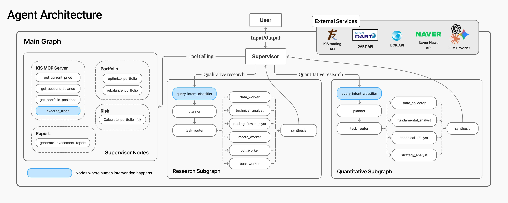

# Seongmin Hwang

**English** · [한국어](./README.ko.md)

I look for where people get stuck, turn what I learn into requirements a system can follow, and test what we build against real scenarios.

## Tech Stack

**Languages**  

**Services & Data**  

**AI & Media**  

**Apps & Integration**  

## Projects

### HAMA · Where should AI pause for human review?

In a two-person capstone, I designed and implemented **how users review the AI's research plan and decide whether to place a simulated order**. We explored five types of review and focused the final demo on two points where the user could make a specific decision. I worked with my teammate on the API contract for progress, approvals, edits, and rejections, then checked the full sequence from request to result against actual server responses.

[Presentation video](https://www.youtube.com/watch?v=WFqmJOUc1qU&t=95s) · [Frontend code](https://github.com/HAMA-team/HAMA-frontend-v2) · Silver Award, 2025 Capstone Design Showcase

<b>See the team's agent architecture</b>

From our final capstone poster. The LangGraph supervisor routes requests to research and quantitative subgraphs or calls portfolio, risk, and trading tools. Blue marks where the user can intervene. I connected the client to the server's progress events and approval API.

[Architecture notes](https://github.com/HAMA-team/HAMA-frontend-v2/blob/main/docs/how_it_works_agent_architecture.md)

<b>See the research plan and order review screens</b>

Users can choose the scope and method of the research, then change the quantity and price when they review a proposed order.

### PromptBall · Getting a baseball highlight tool ready for a user study

**Undergraduate research intern at IXLAB**

PromptBall turns written requests for baseball plays into highlight videos. I automated the **game data preparation pipeline** and improved the experience from selecting a game through replaying a clip. I added WebSocket progress updates and a timeline that jumps to individual clips. For the user study, I improved logging so researchers could trace each request to its results, and compiled viewing times for each participant.

<b>Game data preparation, feedback on failed requests, and video processing</b>

- The pipeline split game footage by inning, transcribed the audio, and generated summaries in one run, including games with extra innings.
- I added separate messages for requests involving a player outside the lineup and plays that did not happen in the selected game, so users knew how to revise their requests.
- I identified video re-encoding as a bottleneck and switched to FFmpeg stream copying. In internal lab tests, generation time per video went **from 3–10 minutes to 10–30 seconds**.

<b>See the original PromptBall screens</b>

*Team and game selection*

*Preparing to generate a highlight*

### Sticky Markdown Note · Pick up where you left off

I built this Electron app because I wanted to keep several notes open beside my work. It **saves notes as `.md` files and restores each open window's position and size** when you reopen the app. I also published a Windows installer.

[Source code](https://github.com/seongmini/sticky-markdown-note) · [Installer](https://github.com/seongmini/sticky-markdown-note/releases/latest)

### TripTrace · The same photos tell different stories by time and distance

TripTrace groups photos into trips using their timestamps and GPS coordinates, then displays them on a map. I implemented the trip segmentation by **treating each photo as a vertex and weighting the edges by elapsed time or distance**. The app builds a minimum spanning tree with Prim's algorithm and cuts edges that exceed the selected threshold.

[Screenshots and design](https://github.com/seongmini/triptrace#readme) · [Trip segmentation code](https://github.com/seongmini/triptrace/blob/master/test/trips.mjs)

<b>Compare the time and distance rules</b>

Say photo 3 was taken in the same neighborhood as photo 2, but two days later. The **24-hour** rule can split them into separate trips, while the **50 km** rule can group them together.

[Time-based view](https://github.com/seongmini/triptrace/blob/master/photosforreadme/triptrace-time-based-trips.png) · [Distance-based view](https://github.com/seongmini/triptrace/blob/master/photosforreadme/triptrace-distance-based-trips.png)

## More Work

- **Campus Go** — In a three-person design project, I traced signup, approval, and cancellation through requirements and the data model. That exposed when pending applicants could be counted as confirmed attendees. Our report covered 34 functional requirements.
- **Coding instruction** — I teach C, Python, and data structures. I also designed criteria for sorting over 1,000 practice problems, reviewed the AI-assisted first pass for gaps in prerequisite order, and used the selection tool in lessons.
- **MoneyHub** — I integrated receipt OCR into a Kotlin Android app so users could review and correct the suggested transaction fields. [Code](https://github.com/seongmini/moneyhub)
- **SOS!** — I worked on quiz grading, saved attempts, and wrong-answer history in a Django learning app. [Code](https://github.com/gom31/WEBSOS)

In a source-grounded AI prototype, I defined when to retrieve evidence and when to let the user freely develop a story. The stack included FastAPI, LangGraph, and Chroma. I used AI coding tools for implementation and tested the behavior myself.
