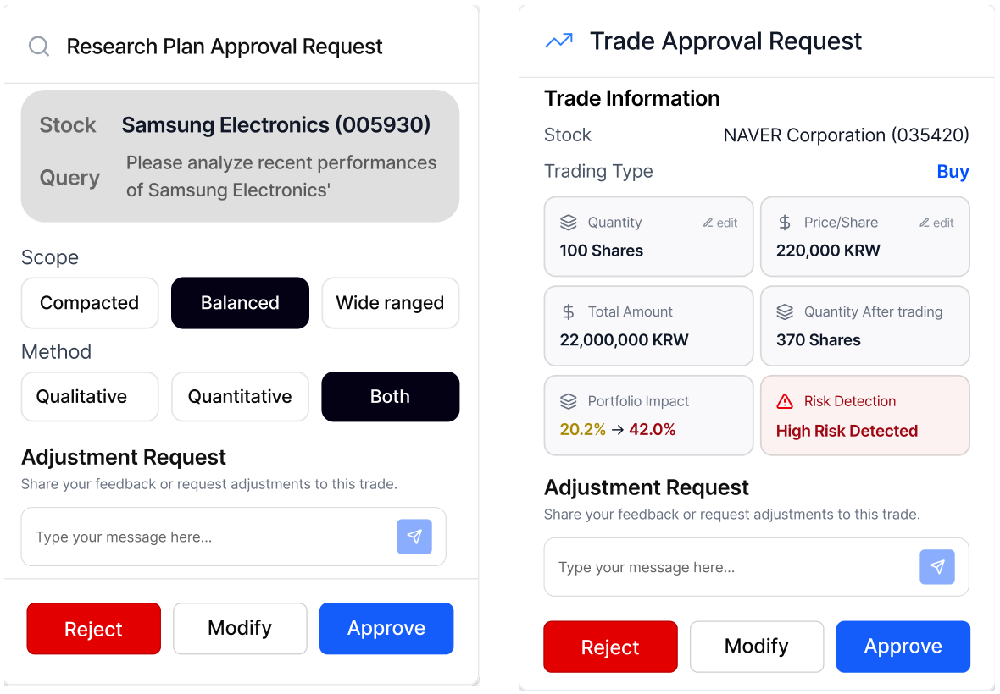
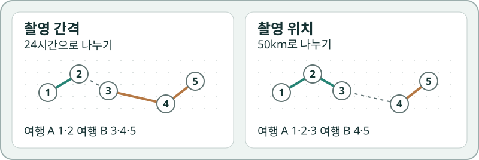

# 황성민 · Seongmin Hwang

**한국어** · [English](./README.en.md)

<picture>
  <source media="(prefers-reduced-motion: reduce)" srcset="assets/project-still.png">
  
</picture>

## 프로젝트

### HAMA · 주문을 보내기 전, 사용자가 바꿀 수 있는 것

2인 캡스톤에서 **AI의 분석 진행과 사용자의 승인·수정·거절을 보여주는 프론트엔드**를 맡았습니다. 최종 시연에서는 분석을 시작하기 전과 모의 주문을 보내기 전 두 곳에 검토를 집중했습니다. Next.js 화면에 SSE 진행 상황을 표시하고, 사용자가 바꾼 주문 조건을 백엔드로 전달했습니다.

[발표 영상](https://www.youtube.com/watch?v=WFqmJOUc1qU&t=95s) · [프론트엔드 코드](https://github.com/HAMA-team/HAMA-frontend-v2) · 2025 캡스톤디자인 발표회 은상

<b>분석 계획과 주문 검토 화면 열기</b>

분석 계획에서는 조사 범위와 방법을 고르고, 주문 화면에서는 수량과 가격을 수정할 수 있습니다.

### TripTrace · 같은 사진도 시간과 거리로 다르게 나뉩니다

촬영 시각과 GPS가 섞인 사진을 여행별로 묶어 지도에 보여줍니다. 저는 **사진을 정점으로 두고 시간 차이 또는 거리를 간선의 가중치로 삼는 여행 분리 로직**을 구현했습니다. Prim으로 최소 신장 트리를 만든 뒤 기준을 초과하는 간선을 끊습니다.

[실행 화면과 설계](https://github.com/seongmini/triptrace#readme) · [여행 분리 구현](https://github.com/seongmini/triptrace/blob/master/test/trips.mjs)

<b>시간 기준과 거리 기준 비교하기</b>

예를 들어 3번 사진이 2번 사진과 같은 동네에서 찍혔지만 이틀 뒤에 찍혔다면, **24시간** 기준에서는 다른 여행으로, **50km** 기준에서는 같은 여행으로 묶일 수 있습니다.

[시간 기준 화면](https://github.com/seongmini/triptrace/blob/master/photosforreadme/triptrace-time-based-trips.png) · [거리 기준 화면](https://github.com/seongmini/triptrace/blob/master/photosforreadme/triptrace-distance-based-trips.png)

### Sticky Markdown Note · 어제 띄워둔 메모가 같은 자리에

작업 창 옆에 여러 메모를 띄워 두고 싶어서 혼자 만든 Electron 앱입니다. **메모를 `.md` 파일로 저장하고, 다시 실행하면 열어둔 창의 위치와 크기를 복원**합니다. Windows 설치 파일도 배포했습니다.

[소스 코드](https://github.com/seongmini/sticky-markdown-note) · [설치 파일](https://github.com/seongmini/sticky-markdown-note/releases/latest)

## IXLAB · 야구 하이라이트를 사용자 실험에 쓰기까지

**PromptBall**은 원하는 야구 장면을 글로 요청하면 하이라이트를 만들어 주는 연구용 서비스입니다. 경기 선택부터 결과 확인까지 React 화면을 개선했습니다. 생성 중에는 완료된 장면 수를 웹소켓으로 보여주고, 결과에서는 타임라인을 눌러 원하는 장면으로 바로 이동할 수 있게 했습니다. 사용자 실험에도 참여해 요청과 생성 결과를 함께 추적할 수 있도록 로그 저장을 보완하고, 참가자별 영상 시청 시간을 정리했습니다.

<b>경기 데이터 준비, 실패 안내, 영상 처리 개선</b>

- 새 경기의 이닝별 영상 분할, 음성 인식, 요약 생성을 한 번에 실행할 수 있게 묶고, 연장전이 있는 경기의 이닝 순서도 처리했습니다.
- 라인업에 없는 선수를 요청한 경우와 경기에서 일어나지 않은 장면을 요청한 경우를 구분해, 사용자가 요청을 바꿔 다시 시도할 수 있게 안내했습니다.
- 영상 재인코딩이 병목임을 확인하고 FFmpeg 스트림 복사를 적용했습니다. 연구실 내부 테스트에서 영상 한 편의 생성 시간이 **3~10분에서 10~30초로** 줄었습니다.

